<!-- CABEÇALHO -->
<h1 align="center">Olá! Eu sou a Amanda ⭐</h1>

<h3 align="center">💻 Estudante de Análise e Desenvolvimento de Sistemas</h3>

  

---

### 🌠 Sobre mim

Me chamo **Amanda**, sou de São Paulo/SP e atualmente curso **Análise e Desenvolvimento de Sistemas na UNICID**.

Sou apaixonada por tecnologia e estou iniciando minha jornada no universo da programação. Gosto de aprender coisas novas, explorar ferramentas e transformar ideias em projetos.

Este GitHub será meu espaço para compartilhar minha evolução, registrar meus aprendizados e desenvolver projetos ao longo da minha trajetória na área de tecnologia. 🚀

---

### 🛠️ Tecnologias e ferramentas

  
  
  
  
  
  

---

### 📚 Atualmente aprendendo

- Desenvolvimento Front-end
- HTML e CSS
- JavaScript
- Banco de Dados e SQL
- Lógica de Programação

---

### 📊 GitHub Stats

  

---

  <i>"A melhor maneira de aprender é colocando a mão na massa."</i> 💙

<h3 align="center">Obrigada pela visita! ✨</h3>

---

---

  💙 Keep coding, keep growing! 🚀

